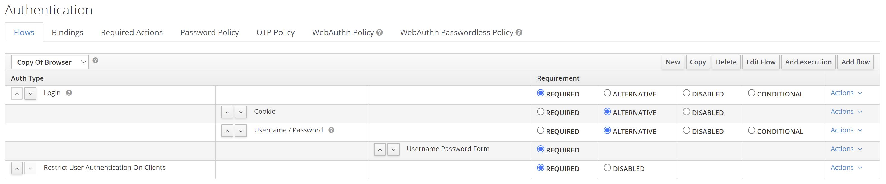
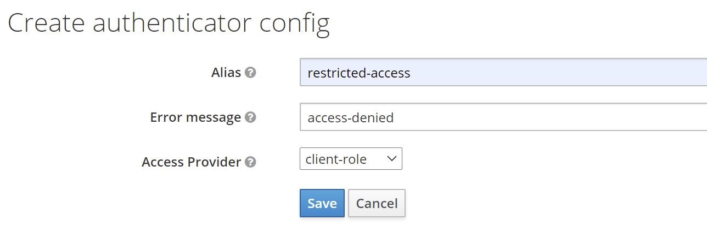
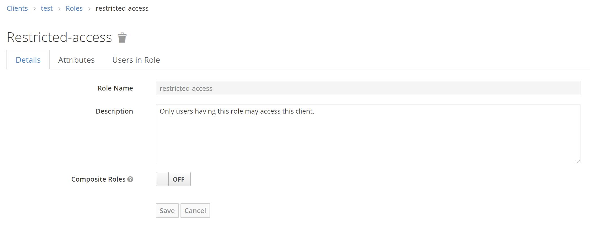
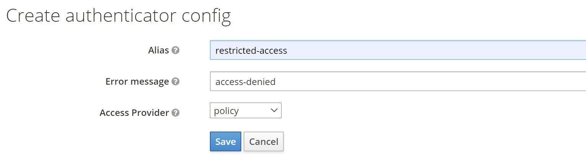
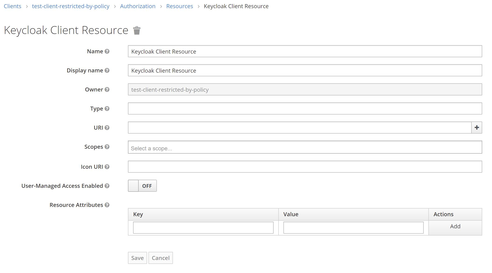
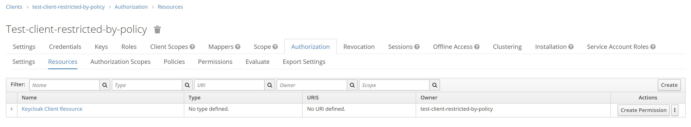
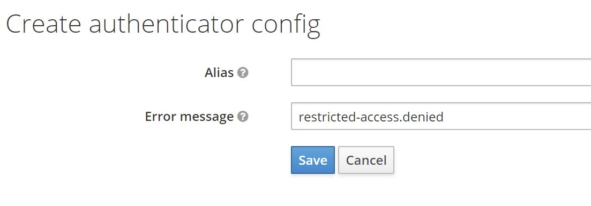

# Keycloak: Restrict user authorization on clients

This is a simple Keycloak authenticator to restrict user authorization on clients.


[](https://codescene.io/projects/25589)

## Quick introduction (Video interview with Niko Köbler)
[](https://www.youtube.com/watch?v=eQjOCrcit24)

## What is it good for?

As a Keycloak consultant, I often receive inquiries about restricting user authorization for specific clients. People commonly ask,

> Can I allow certain users to authenticate with a client while denying access to others?

While the answer used to be "no" for out-of-the-box Keycloak, I have developed this extension to meet this need.  but I recommend taking the time to understand the potential security implications before using this extension.

So, before using this extension, please take a moment to review the security considerations outlined in the  [security consideration](#security-considerations) section.

## How does it work?

The authenticator can work either role-based or policy-based.

### Role-based mode

In this mode, the authenticator uses client roles to restrict authentication. It works like this:

* The authenticator checks whether a client defines a role named `restricted-access`
    * If it does the authenticator checks whether the user has that role
        * If it does, the authenticator returns success (i.e. authentication is successful)
        * If it does not, the authenticator returns failure (i.e. authentication is unsuccessful)
    * If it does not, the authenticator returns success (i.e. authentication is successful).

This means that you can enable the authenticator on a per-client basis by adding a client role named `restricted-access` to your client.
A client with that role has the authenticator enabled. Only users with that role can authenticate to that client.

### Policy-based mode

In this mode, the authenticator uses client resources, permissions and policies to restrict authentication.
This mode only works for confidential OIDC clients with authorization enabled.
It works like this:

* The authenticator checks whether a client defines a resource named `Keycloak Client Resource`
    * If it does, the authenticator checks whether policies and permission evaluate to `PERMIT`
        * If it does, the authenticator returns success (i.e. authentication is successful)
        * If it does not, the authenticator returns failure (i.e. authentication is unsuccessful)
    * If it does not, the authenticator returns success (i.e. authentication is successful).

This means that you can enable the authenticator on a per-client basis by adding a resource named `Keycloak Client Resource` to your client.
A client with that resource has the authenticator enabled. Users will only be able to authenticate to such a client if the associated policies and permission permit access.

## Restrict clients, not flows

The extension started as an authenticator: access was checked wherever you added it to an authentication flow, using the access provider you configured for it. Every path that did not run through such a flow, e.g. single sign-on, identity provider redirects, password reset, refreshing or exchanging tokens, was not checked.

The extension now follows a different approach: **the restriction belongs to the client, and access is checked on every path.**
You restrict a client by adding the client role or the resource. You no longer need to make sure that every flow contains the authenticator and that each authenticator uses the right access provider.

| | Authenticator only | Required action and client policy executor |
|---|---|---|
| Where restrictions are defined | Per client: client role or resource | Per client: client role or resource |
| Where access is checked | Only in flows that contain the authenticator | At the end of every login, no matter which flow, and whenever tokens are issued, incl. refresh and token exchange |
| Which restrictions are checked | Only those of the configured access provider | All restrictions a client has (`auto` access provider) |
| Configuration | Per flow and per authenticator | Once per realm |

[Denying access by default](#denying-access-by-default) takes this one step further: instead of protecting the clients you restrict, it protects all clients and lets you decide who may access the clients you have not restricted.

This is more secure, but you need to think about access differently:
* **Restricting a client restricts it everywhere.** If a client has the client role or the resource, users without access cannot get tokens for it anymore, no matter how they log in. Restrictions you only meant for one flow apply to all paths.
* **Leftovers count.** A `Keycloak Client Resource` without a permission, e.g. from an experiment, denies access to everyone. Remove restrictions you do not use.
* **Losing access takes effect immediately.** If you remove a user's role, the next token refresh fails, instead of the user keeping access until the session ends.

### Recommended setup

1) Restrict clients by adding the client role or the resource, manually or via the `restrict-client-auth-auto-config` [client policy executor](#executors).
2) Enable the [required action](#required-action-support). It checks access at the end of every login.
3) Create a client policy with the `any-client` condition and the `restrict-client-auth-enforce` [client policy executor](#executors). It checks access whenever tokens are issued.
4) Optionally, [deny access by default](#denying-access-by-default).
5) Optionally, keep the authenticator in your flows, e.g. to deny access before other required actions run, or to return a dedicated error for the resource owner password credentials grant.

## How to install?

Download a release (*.jar file) that works with your Keycloak version from the [list of releases](https://github.com/sventorben/keycloak-restrict-client-auth/releases).
Follow the below instructions depending on your distribution and runtime environment.

### Standalone (without container)

Copy the jar to the `providers` folder and execute the following command:

```shell
${kc.home.dir}/bin/kc.sh build
```

### Container image (Docker)

For Docker-based setups mount or copy the jar to `/opt/keycloak/providers`.

If you are using RedHat SSO instead of Keycloak open source, mount or copy the jar to `/opt/eap/providers/`.

You may want to check [docker-compose.yml](docker-compose.yml) as an example.

### Maven/Gradle

Packages are being released to GitHub Packages. You find the coordinates [here](https://github.com/sventorben/keycloak-restrict-client-auth/packages/779937/versions)!

It may happen that I remove older packages without prior notice, because the storage is limited on the free tier.

## How to configure?

* Create a new flow per binding (e.g. browser flow, direct grant flow etc.)
* Add a sub-flow e.g. named `Login` and mark it as `Required`
* Add an authenticator execution `Restrict user authentication on clients` and mark the execution as `Required`.
* Within the `Login` sub-flow add authenticators/executions/conditionals and further sub-flows as needed (
  see [Keycload documentation for details](https://www.keycloak.org/docs/latest/server_admin/#_authentication-flows)
* Then bind your newly created flow as desired - either as a default for the whole realm or on a per-client basis.

  See the image below for an example.


* Follow instructions below in section [Client Role based mode](#client-role-based-mode) or [Resource Policy based mode](#resource-policy-based-mode) for the desired mode, respectively.

> ⚠️ **User identity**:
>
> The authenticator needs a user identity to check whether the user has the desired role or not. Hence, ensure that you have steps/executions in your flow prior to this authenticator that can ensure user's identity.

### Client Role based mode

1) Configure the authenticator by clicking on `Actions -> Config` and select `client-role` as the `Access Provider`.

2) Add a role named `restricted-access` to the client you want to restrict access to.

   See the image below for an example.

3) Afterwards, no user can authenticate to this client. To allow a user to authenticate, assign the role `restricted-access` to the user. You may do so either by assigning the role to the user directly or via groups or combined roles.

#### Changing the role name

You do not like the role name `restricted-access` or you do have some kind of naming conventions in place? You can change the role name globally by configuring the provider.

```properties
spi-restrict-client-auth-access-provider-client-role-enabled=true
spi-restrict-client-auth-access-provider-client-role-client-role-name=custom-role
```

For details on SPI and provider configuration, please refer to [Configuring providers](https://www.keycloak.org/server/configuration-provider) guide.

### Resource Policy based mode

> ⚠️ **OIDC only**:
>
> Policy-based mode only works with OIDC clients (`Client Protocol` must be `openid-connect`)


1) Configure the authenticator by clicking on `Actions -> Config` and select `policy` as the `Access Provider`.

2) Configure the `Access Type` of the client to `confidential`
3) Set `Authorization Enabled` to `on`
4) Go to `Authorization -> Resources` and click `Create` to create a new resource
   
5) Set the `Name` and `Display name` to `Keycloak Client Resource` and keep the other fields blank
6) Save the resource
   
7) Click `Create Permission` to add permissions and policies (see [Authorization Services Guide](https://www.keycloak.org/docs/latest/authorization_services/#_permission_overview) for details)
8) Afterwards, no user can authenticate to this client unless permissions have been granted by configured policies.

### Automatic mode

If you use both modes in the same realm, select the access provider `auto`. For example, use client roles for public clients and policies for confidential clients, since Keycloak does not allow authorization services for public clients.

The `auto` access provider determines per client which restriction applies:
* A client is restricted if any installed access provider restricts it, e.g. if it has the client role or the resource.
* Access is only permitted if all access providers that restrict the client permit it.

`auto` considers all installed access providers, including custom ones. The [required action](#required-action-support) and the `restrict-client-auth-enforce` [client policy executor](#executors) always use `auto`. For the authenticator, select `auto` explicitly; its default access provider remains `client-role`.

The `restrict-client-auth-auto-config` client policy executor does not support `auto`, since it needs to know how to restrict access to a client.

### Using a custom error message

If a user tries to log in via a browser-based flow and access gets denied by the authenticator, a custom error message can be displayed.
In the flow choose the `Actions` button and then choose `Config`. You will see the following configuration screen.



You can directly define a particular message or use a property, which will be used for mapping the error message. If you choose a property, the property will be looked up from your custom theme's `messages*.properties` files and therefore supports internationalization.

```properties
# messages.properties
restricted-access.denied=Access denied. User is missing required role 'restricted-access'
# messages_de.properties
restricted-access.denied=Zugriff verweigert. Dem Benutzer fehlt die notwendige Rolle 'restricted-access'.
```

If the field is left blank, default property `access-denied` is used. In this case you do not need a custom theme, since this property comes with Keycloak out of the box.
For details on how to add custom messages to Keycloak, please refer to section [Messages and Internationalization](https://www.keycloak.org/docs/latest/server_development/#messages) in the server developer guide.

### Configuring Post-Authentication Flows for Identity Provider Redirects
When your authentication flow includes an identity provider redirect (e.g., using the organization feature, Identity Provider Redirector, or Home IDP Discovery Extension), Keycloak does not execute subsequent steps in the authentication flow after the redirect. To work around this limitation, you can configure a post-login flow for the identity provider. This ensures that the required steps, such as authorization checks, are applied after authentication with the external identity provider.

Follow these steps to configure your post-login flow:

1) Create a Custom Authentication Flow:
    * Log in to the Keycloak Admin Console with your administrator credentials.
    * Go to `Authentication` from the left-hand menu.
    
    * Under the `Flows` tab, click `Create Flow`.
    
    * Enter a name for the flow, such as `Restrict Authentication Post Login Flow`, and select `Generic` as the flow type.
    * Click `Save`.
    * After creating the flow, click `Add Step` to add steps to the flow.
    * Add the step `Restrict User Authentication on Clients` to ensure authorization checks are applied.


2) Assign the Post-Login Flow to the Identity Provider:

    * Go to `Identity Providers` in the Keycloak Admin Console.
    
    * Select the identity provider (e.g., "Google") used in the redirect flow.
    * In the IDP settings, locate the `Post login flow` option.
    * Assign the newly created authentication flow (e.g., `Restrict Authentication Post Login Flow`) to this setting.
    

This configuration ensures that the post-login flow is applied whenever the identity provider is used for authentication. It allows the necessary checks and steps to be enforced even though Keycloak does not execute steps following the identity provider redirect.

#### Why This Configuration is Necessary
Keycloak currently skips subsequent steps in the authentication flow after an identity provider redirect. This is a known issue tracked in the Keycloak repository [issue #10250](https://github.com/keycloak/keycloak/issues/10250#issuecomment-2556581319). Using a post-login flow as described above is the recommended workaround for scenarios where additional steps, such as client-specific authorization checks, are needed after authentication via an external identity provider.

## Required action support

This extension provides a [required action](https://www.keycloak.org/docs/latest/server_admin/#con-required-actions_server_administration_guide) named `Restrict user authentication on clients` (`restrict-client-auth-enforce`).
Unlike the authenticator, the required action does not need to be added to any authentication flow.
Keycloak evaluates it whenever a user authenticates, no matter which authentication flow has been used, e.g. for login via username and password, single sign-on, identity providers, registration, credential reset, or links sent via email.

The required action always uses the [`auto` access provider](#automatic-mode), i.e. it checks all restrictions a client has.

Since Keycloak runs required actions after the authentication flow, access is checked after other required actions have been completed.
For example, users are able to reset their password before access to the client is denied.

To enable the required action:
1) Go to `Authentication` and choose the `Required actions` tab.
2) Enable `Restrict user authentication on clients`.
3) Keep it at the bottom of the list, so that other required actions run first. Keycloak puts newly enabled required actions at the bottom by default.
4) Optionally, configure the [realm settings](#realm-settings) and the error message.

Please note:
* Applications cannot initiate the required action via the `kc_action` parameter.
* For the resource owner password credentials grant (direct access grant), Keycloak denies access with an `Account is not fully set up` error instead. Add the authenticator to the direct grant flow or use the `restrict-client-auth-enforce` [client policy executor](#executors) for a dedicated error.

### Realm settings

The configuration of the required action also holds settings for the whole realm.
`Deny access by default` and `Default access role` apply to all enforcement points of the realm: the authenticator, the required action, and the `restrict-client-auth-enforce` and `restrict-client-auth-auto-config` [client policy executors](#executors).
They apply even if the required action is disabled. It only has to be registered.

| Setting | Key | Applies to | Description |
|---|---|---|---|
| Error message | `restrictClientAuthErrorMessage` | Required action | The error message shown by the required action, see [Using a custom error message](#using-a-custom-error-message). |
| Deny access by default | `defaultDeny` | Whole realm | If enabled, all clients of the realm are restricted. See [Denying access by default](#denying-access-by-default). |
| Default access role | `defaultAccessRole` | Whole realm | If access is denied by default, users with this role may access all clients that are not restricted by the access provider. Use the role name for realm roles and `client-id.role-name` for client roles. |

Without these settings, the extension behaves exactly as before.

If the default access role does not exist, access to clients that are not restricted by the access provider is denied and a warning is logged.

#### Configuring realm settings in the admin console

1) Go to `Authentication` and choose the `Required actions` tab.
2) If `Restrict user authentication on clients` is not registered yet, enable it. If you only want to use the realm settings, disable it again afterwards.
3) Choose the gear icon of `Restrict user authentication on clients` and configure the settings.

The admin console validates the settings when saving. Access providers and default access roles that do not exist are rejected.

#### Configuring realm settings via the admin REST API

```shell
# Register the required action, if not registered yet
curl -X POST "$KEYCLOAK_URL/admin/realms/$REALM/authentication/register-required-action" \
  -H "Authorization: Bearer $ACCESS_TOKEN" -H "Content-Type: application/json" \
  -d '{"providerId": "restrict-client-auth-enforce", "name": "Restrict user authentication on clients"}'

# Configure the realm settings
curl -X PUT "$KEYCLOAK_URL/admin/realms/$REALM/authentication/required-actions/restrict-client-auth-enforce/config" \
  -H "Authorization: Bearer $ACCESS_TOKEN" -H "Content-Type: application/json" \
  -d '{"config": {"accessProviderId": "client-role", "defaultDeny": "true", "defaultAccessRole": "default-access"}}'
```

The `config` endpoint validates the settings and responds with `400 Bad Request` if an access provider or default access role does not exist.

#### Configuring realm settings via Terraform

Use the `keycloak_required_action` resource of the [Keycloak Terraform provider](https://registry.terraform.io/providers/keycloak/keycloak/latest/docs/resources/required_action):

```hcl
resource "keycloak_required_action" "restrict_client_auth" {
  realm_id = keycloak_realm.realm.realm
  alias    = "restrict-client-auth-enforce"
  name     = "Restrict user authentication on clients"
  enabled  = true
  config = {
    accessProviderId  = "client-role"
    defaultDeny       = "true"
    defaultAccessRole = "default-access"
  }
}
```

#### Realm export and import

The realm settings are part of the required action in the realm representation and hence part of realm exports and imports, e.g. with [keycloak-config-cli](https://github.com/adorsys/keycloak-config-cli):

```json
"requiredActions": [
  {
    "alias": "restrict-client-auth-enforce",
    "name": "Restrict user authentication on clients",
    "providerId": "restrict-client-auth-enforce",
    "enabled": true,
    "config": {
      "accessProviderId": "client-role",
      "defaultDeny": "true",
      "defaultAccessRole": "default-access"
    }
  }
]
```

> ⚠️ **Validation**: Keycloak only validates the realm settings when they are saved via the admin console or the `config` endpoint. Settings applied via Terraform, which uses the required action endpoint, or via realm import are not validated. Invalid settings deny access at runtime and are logged as warnings, so check the logs after applying them.

### Denying access by default

By default, only restricted clients restrict access, i.e. clients that have the client role (client role based mode) or the resource (resource policy based mode). All other clients are accessible to all users. If you forget to restrict a client, e.g. when introducing a new user pool, all users can access it.

If you enable `Deny access by default` in the realm settings, all clients of the realm are restricted:
* Access to clients that are restricted by the access provider is decided as usual.
* Access to all other clients is only permitted for users with the default access role. If no default access role is set, access to these clients is denied.
* If the access provider of an authenticator, the required action, or a client policy executor does not exist, it denies access to all clients.

The required action and the `restrict-client-auth-enforce` client policy executor apply this to all restrictions a client has, since they always use the [`auto` access provider](#automatic-mode). Each authenticator applies it to its own access provider. If you use different access providers in the same realm, select `auto` for your authenticators as well.

For example, assign the default access role to your existing users via a group. They keep access to all existing clients. Users without the role, e.g. users of a new user pool, may only access clients that are restricted and that they have been granted access to. If you forget to restrict a client, users without the default access role cannot access it.

Do not add the default access role to the realm's default roles, since all new users get these roles.

> ⚠️ **Built-in clients**:
>
> Denying access by default also applies to Keycloak's built-in clients, e.g. `account-console`. In the admin realm (`master` by default), it also applies to `security-admin-console` and `admin-cli`. Make sure that administrators can still access the admin console and admin REST API before denying access by default in the admin realm. Keycloak logs a warning if access is denied by default in the admin realm.

## Client Policy support

> ⚠️ **Feature preview**:
>
> Support for client policies is currently feature preview. I am happy to get some feedback on this.
> However, depending on feedback the feature may be changed  or even be removed again in the future.

Since version 18.1.0 this extension has basic built-in support for [client policies](https://www.keycloak.org/docs/latest/server_admin/#_client_policies).

### Conditions
This extension provides a [client policy condition](https://www.keycloak.org/docs/latest/server_admin/#condition) named `restrict-client-auth-enabled` to check whether user authentication on a client has been restricted or not.

### Executors
This extension provides a [client policy executor](https://www.keycfloak.org/docs/latest/server_admin/#executor) named `restrict-client-auth-auto-config` to automatically enable restricted access for clients. The executor can be cofigured to either enable restricted access based on resource policies or based on client role.

This extension also provides a client policy executor named `restrict-client-auth-enforce` to deny issuing tokens for users who do not have access to a restricted client (anymore).
Unlike the authenticator, the executor does not depend on authentication flows. Keycloak does not run any authentication flow when a client refreshes or exchanges a token, and the authenticator may be skipped during login, e.g. if users log in via single sign-on or an identity provider.
The executor checks access
* whenever an authorization code is exchanged for tokens, and when tokens are issued via the resource owner password credentials grant or the JWT authorization grant (Keycloak 26.8 or later). It responds with an `invalid_grant` error if access is denied.
* whenever tokens are issued via the device authorization grant, client initiated backchannel authentication (CIBA), or the implicit or hybrid flow. It responds with an `access_denied` error if access is denied.
* whenever a token, including an offline token, is refreshed. It responds with an `invalid_grant` error if access is denied.
* whenever a token is exchanged using [standard token exchange](https://www.keycloak.org/securing-apps/token-exchange). It checks access to the requesting client and to all clients requested via the `audience` parameter and responds with an `access_denied` error if access is denied to any of them. This requires Keycloak 26.8 or later. Legacy token exchange (V1), e.g. impersonation or external to internal token exchange, is not covered.

Tokens for service accounts (client credentials grant) are not checked. SAML clients are not covered either, since SAML does not use the token endpoint.

The executor always uses the [`auto` access provider](#automatic-mode), i.e. it checks all restrictions a client has.

By default, the executor checks access to the client the tokens are issued for, i.e. the authorized party (`azp`), and, for token exchange, to the requested audience.
Access tokens may contain further clients in their audience (`aud`), e.g. added by audience mappers or because the user has roles of these clients.
Enable the `Check audience` option (`checkAudience`) to also check access to all clients in the audience of the access token. Tokens are denied if the user does not have access to any of them. Audience values that are no client IDs of the realm are ignored.

To enable the executor:
1) Create a client profile and add the `restrict-client-auth-enforce` executor to it.
2) Create a client policy with the `any-client` condition and add the client profile to it.

> **Note**: The `restrict-client-auth-enabled` condition only applies when clients are registered or updated. It cannot be used together with the `restrict-client-auth-enforce` executor.

## Security considerations

### Policy enforcement
To avoid any confusion, it is important to note that this extension is not a policy enforcement point (PEP).
It does not enforce authorization decisions. It is part of making the authorization decision, but it does not enforce it.
Clients must enforce decisions being made.

According to the [OIDC specification/OpenID Connect Core 1.0 incorporating errata set 1](https://openid.net/specs/openid-connect-core-1_0.html#IDTokenValidation), it is the responsibility of the client to check the audience claims. Section 3.1.3.7. ID Token validation, point 3ff state that
> The Client MUST validate that the `aud` (audience) Claim contains its `client_id` value registered at the Issuer identified by the `iss` (issuer) Claim as an audience. [...]

And further it is very clear about the enforcement by the client:
> The ID Token MUST be rejected if the ID Token does not list the Client as a valid audience, or if it contains additional audiences not trusted by the Client.
> If the ID Token contains multiple audiences, the Client SHOULD verify that an `azp` Claim is present.
> If an `azp` (authorized party) Claim is present, the Client SHOULD verify that its client_id is the Claim Value.

So, by design this extension cannot be a PEP.

What this extension supports you with is authorization decision-making and communicating the outcome to the user during login flow. If configured correctly, it will prevent issuance of tokens that contain an authorized party claim for a client that users do not have access to. To also prevent issuance of tokens that contain such a client in their audience, enable the `Check audience` option of the `restrict-client-auth-enforce` [client policy executor](#executors).

Token issuance or non-issuance is (beside claims in the token) just one way to communicate the outcome of authorization decision-making. It is not enforcement of the decision.

Make sure your clients enforce decisions correctly and ensure validation auf `aud` (audience) and `azp` (authorized party) claims.

If you are using a Keycloak adapter, make sure your clients are verifying the audience claim by enabling `verify-token-audience` in your [adapter config](https://www.keycloak.org/docs/latest/securing_apps/#_java_adapter_config).

### Protect all possible flows

The [recommended setup](#recommended-setup) checks access on all paths. If you only use the authenticator, ensure that you protect authentication to your clients in all flows a user may access. This includes not just the browser flow or the other realm-wide flows, but also identity provider overrides and post login flows.

Here is one example: suppose a user tries to log in via the built-in browser flow, at the end of which you have added the "Restrict user authentication on clients" step. If the "Cookie" or "Forms" alternative is used, the user will proceed to this step and be evaluated. But if it is the "Identity Provider Redirector" alternative which gets used, the subsequent steps will be skipped and the user will not be subject to this validation (this is a general feature of how brokering works in Keycloak authentication flows, not specific to this plugin). This extension must also be configured in the identity provider's post login flow in order to apply.

To check access no matter which authentication flow has been used, enable the [required action](#required-action-support) in addition to or instead of the authenticator.

Refreshing or exchanging tokens does not run any authentication flow at all. If users should lose access when their roles or permissions change, configure the `restrict-client-auth-enforce` [client policy executor](#executors). For OpenID Connect clients, the executor also denies issuing tokens if the authenticator has been skipped during login.

#### Identity Provider redirects
To ensure proper enforcement of authorization checks when using identity provider redirects in your authentication flow (e.g., with the Identity Provider Redirector, organization feature, or Home IDP Discovery Extension), Keycloak does not automatically execute subsequent steps after the redirect. You must configure a post-login flow for the identity provider to apply the necessary checks. For detailed steps, refer to [Configuring Post-Authentication Flows for Identity Provider Redirects](#configuring-post-authentication-flows-for-identity-provider-redirects).

### Permissions to change access

Keycloak's [fine-grained admin permissions](https://www.keycloak.org/docs/latest/server_admin/#_fine_grained_permissions) control who may change which part of the access control:

| What | Required permission |
|---|---|
| Change the [realm settings](#realm-settings) | Realm role `manage-realm` of the `realm-management` client. Fine-grained admin permissions do not cover realm settings. |
| Restrict a client or remove the restriction, i.e. create or delete the client role or the resource | `manage` on the client |
| Grant a user access to a restricted client via the client role | `map-roles` on the user and `map-role` on the client role |
| Grant access via a group | `manage-membership` on the group |
| Grant the default access role, i.e. access to all clients that are not restricted | `map-role` on the default access role. Restrict this permission to as few administrators as possible. |

Without [denying access by default](#denying-access-by-default), administrators who may manage a client can remove its restriction and thereby grant access to all users. If access is denied by default, removing the restriction only grants access to users with the default access role.

### Disable the `Audience Resolve` mapper if necessary
The [`Audience Resolve` protocol mapper](https://www.keycloak.org/docs/latest/server_admin/#_audience_resolve) is enabled by default by client scope `roles`, but it may be necessary to remove it in some cases.
Failing to set up audience claims correctly may result in a token containing the restricted client as an audience claim, even if the user does not have access to that client.

## Frequently asked questions

### Does it work with Keycloak version X.Y.Z?

If you are using Keycloak version `X` (e.g. `X.y.z`), version `X.b.c` should be compatible.
Keycloak SPIs are quite stable. So, there is a high chance this authenticator will work with other versions, too. Check the details of latest [compatibility test run](https://github.com/sventorben/keycloak-restrict-client-auth/actions/workflows/matrix.yml) for an overview or simply give it a try.

Authenticator version `X.b.c` is compiled against Keycloak version `X.y.z`. For example, version `16.3.1` will be compiled against Keycloak version `16.y.z`.

I do not guarantee what version `a.b` or `y.z` will be. Neither do I backport features to older version, nor maintain any older versions of this authenticator. If you need the latest features or bugfixes for an older version, please fork this project or update your Keycloak instance. I recommend doing the latter on regular basis anyways.

### Why not use "Allow/Deny Access" authenticators with conditions?

With Keycloak 13 two new authenticators have been added, namely `Allow Access` and `Deny Access`. Together with `Condition - User Role` authenticator authentication may be restricted in a similar way with out-of-the-box features. So, the question is why not use that and override authentication flows on a per client basis?

Here are some reasons/thoughts
* It is not really flexible. Since `Condition - User Role` only allows for checking one concrete (realm or client-specific) role, a very complex flow handling all clients, or a totally separate flow for each individual client would be needed.
* It simply does not work well with federated authentication (ie. identity provider redirects), since there is no way to configure client specific behaviour for `First login flow` or `Post login flows`. In other words, there is no feature like `Authentication flow overrides` at an IdP level. Hence, the same flow will be used for all clients. As said before, this becomes very complicated.

### Getting error KC-SERVICES0013: Failed authentication

When getting an error or warning like this,
```
WARN  [org.keycloak.authentication.DefaultAuthenticationFlow] (default task-26) REQUIRED and ALTERNATIVE elements at same level! Those alternative executions will be ignored: [auth-cookie, identity-
provider-redirector, null]
WARN  [org.keycloak.services] (default task-26) KC-SERVICES0013: Failed authentication: org.keycloak.authentication.AuthenticationFlowException: authenticator: restrict-client-auth-authenticator
```

you have mostlikely mixed required and alternative subflows/steps/authenticators at the same level in your custom flow.
Keycloak does not support this.

Make sure you do not combine required and alternative authenticators at the same level.
See the following image for details:


