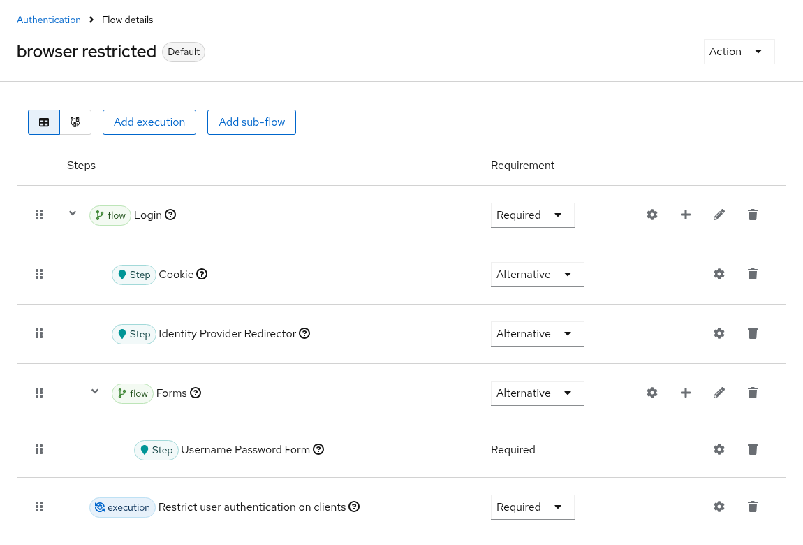
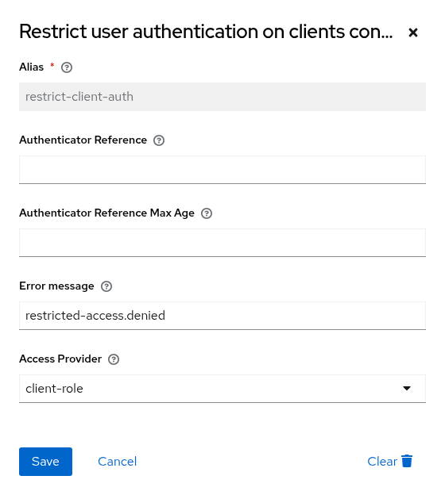

# Authenticator and flows
{: .no_toc }

## Table of contents
{: .no_toc .text-delta }

1. TOC
{:toc}

---

The [required action](configuration.html#required-action) and the `restrict-client-auth-enforce` [client policy executor](configuration.html#checking-access-whenever-tokens-are-issued) check access no matter which authentication flow has been used. You do not need the authenticator for that.

Add the authenticator to a flow if you want to
* deny access within the flow, i.e. before other required actions run, e.g. before users are asked to update their profile or to configure OTP,
* show a different [error message](error-messages.html) for certain clients, via a flow override per client,
* return a dedicated error for the resource owner password credentials grant instead of `Account is not fully set up`.

## Adding the authenticator to a flow

* Create a new flow per binding (e.g. browser flow, direct grant flow etc.)
* Add a sub-flow e.g. named `Login` and mark it as `Required`
* Within the `Login` sub-flow add authenticators/executions/conditionals and further sub-flows as needed (see [Keycloak documentation for details](https://www.keycloak.org/docs/latest/server_admin/#_authentication-flows))
* Add the step `Restrict user authentication on clients` after the `Login` sub-flow and mark it as `Required`.
* Then bind your newly created flow as desired - either as a default for the whole realm or on a per-client basis.

See the image below for an example.



{: .warning }
> The authenticator needs a user identity to check whether the user has access or not. Hence, ensure that you have steps in your flow prior to this authenticator that identify the user.

{: .warning }
> Do not combine `Required` and `Alternative` steps at the same level, and do not add the authenticator as an `Alternative`. Keycloak lets users choose between alternatives, e.g. via "Try another way", so users who are denied by one restriction could pick another one. See [Getting error KC-SERVICES0013](faq.html#getting-error-kc-services0013-failed-authentication).

## Configuring the authenticator

Choose the gear icon of the `Restrict user authentication on clients` step.



| Option | Key | Description |
|---|---|---|
| Error message | `restrictClientAuthErrorMessage` | The error message shown if access is denied, see [error messages](error-messages.html). |
| Access Provider | `accessProviderId` | The access provider that decides which clients are restricted: `client-role`, `policy`, or `auto` for [both](configuration.html#using-client-roles-and-policies-in-the-same-realm). If not set, the [server-wide default access provider](#server-wide-default-access-provider) is used. |

### Server-wide default access provider

Authenticators without a configured access provider use the server-wide default access provider. If none is configured, they use `client-role`.

Set the server-wide default access provider via the server configuration, e.g. in `conf/keycloak.conf`:

```properties
spi-restrict-client-auth-access-provider--provider-default=policy
```

Keycloak 26.2 does not support this format with `--` separators and ignores it. Use `spi-restrict-client-auth-access-provider-provider-default=policy` there.

{: .warning }
> Use `provider-default`, not `provider`. The `provider` option makes the given access provider the only one, so all other access providers, including `auto`, are not available anymore. The required action and the `restrict-client-auth-enforce` client policy executor then log a warning and use the given access provider instead of `auto`, i.e. they ignore all other restrictions.

### Error responses for non-browser requests

For requests that do not accept HTML, e.g. the resource owner password credentials grant, the authenticator responds with an error according to [RFC 6749](https://www.rfc-editor.org/rfc/rfc6749#section-5.2) instead of an error page, so OAuth client libraries can handle it:

| Endpoint | Status | Error |
|---|---|---|
| Token endpoint, i.e. the resource owner password credentials grant | `400` | `invalid_grant` |
| Other endpoints | `403` | `access_denied` |

The required action and the `restrict-client-auth-enforce` client policy executor respond with standard errors as well.

## Other flows

Keycloak does not run the browser flow for every path a user may take. The table shows which enforcement point covers which path.

| Path | Required action | Client policy executor | Authenticator |
|---|---|---|---|
| Login via browser flow | ✔ | ✔ (OpenID Connect) | ✔ if in the browser flow |
| Single sign-on (cookie) | ✔ | ✔ (OpenID Connect) | ✔ if in the browser flow, after the `Cookie` step |
| Identity provider redirects, organizations | ✔ | ✔ (OpenID Connect) | Only via a post login flow, see [below](#identity-provider-redirects) |
| First login via an identity provider | ✔ | ✔ (OpenID Connect) | Only via a post login flow |
| Device authorization grant | ✔ during the login in the browser | ✔ | ✔ if in the browser flow |
| Registration | ✔ | ✔ (OpenID Connect) | Not by default |
| Reset credentials | ✔ | ✔ (OpenID Connect) | Not by default |
| Links sent via email (action tokens) | ✔ | ✔ (OpenID Connect) | No |
| Resource owner password credentials (direct grant) | Denied with `Account is not fully set up` | ✔ | ✔ if in the direct grant flow |
| Refresh token, offline token | No | ✔ | No |
| Token exchange | No | ✔ (Keycloak 26.8 or later) | No |
| CIBA, JWT authorization grant | No | ✔ | No |
| Client credentials (service accounts) | No | Optional, see [Checking service accounts](configuration.html#checking-service-accounts) | No |

### Registration

Keycloak creates the user account before the required action runs. Users without access to the client can register, but cannot log in to the client. Only allow registration for clients users may access after registering, or grant access to new users, e.g. via a default group.

### Reset credentials

The required action runs after the reset credentials flow. Users can reset their password, but cannot log in to clients they do not have access to afterwards.

### Identity provider redirects

When your authentication flow includes an identity provider redirect (e.g., using the organization feature, Identity Provider Redirector, or [Home IdP Discovery](https://github.com/sventorben/keycloak-home-idp-discovery)), Keycloak does not execute subsequent steps in the authentication flow after the redirect. This is a known issue tracked in [Keycloak issue #10250](https://github.com/keycloak/keycloak/issues/10250#issuecomment-2556581319).

The required action checks access after the redirect, so you do not need to do anything if it is enabled. If you only use the authenticator, configure a post login flow for the identity provider:

1. Create a custom authentication flow:
    * Go to `Authentication` from the left-hand menu.
    
    * Under the `Flows` tab, click `Create Flow`.
    
    * Enter a name for the flow, such as `Restrict Authentication Post Login Flow`, and select `Generic` as the flow type.
    * Click `Save`.
    * After creating the flow, click `Add Step` to add steps to the flow.
    * Add the step `Restrict user authentication on clients`.
2. Assign the post login flow to the identity provider:
    * Go to `Identity Providers`.
    
    * Select the identity provider (e.g., "Google") used in the redirect flow.
    * In the settings of the identity provider, locate the `Post login flow` option.
    * Assign the newly created authentication flow (e.g., `Restrict Authentication Post Login Flow`) to this setting.
    

Repeat this for every identity provider users may log in with.

### Direct grant

Keycloak evaluates required actions for the resource owner password credentials grant, but cannot show them to the user. If the required action denies access, Keycloak responds with `invalid_grant` and `Account is not fully set up`. For a dedicated error, add the authenticator to the direct grant flow, which responds with `invalid_grant` and `Access to client is denied.`, or use the `restrict-client-auth-enforce` [client policy executor](configuration.html#checking-access-whenever-tokens-are-issued).
