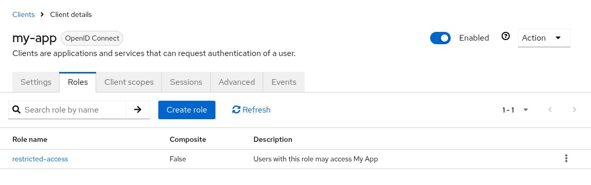
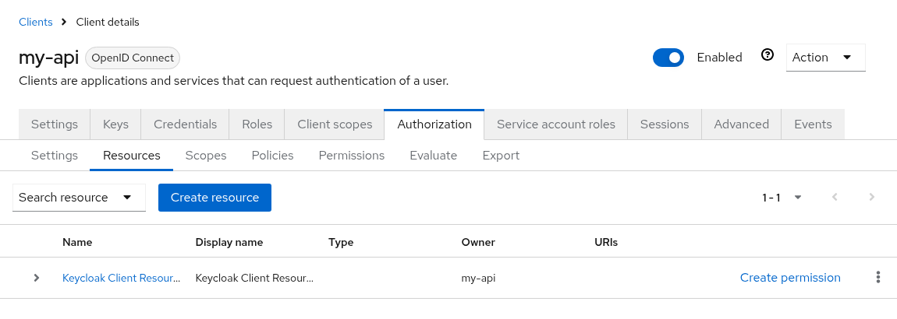
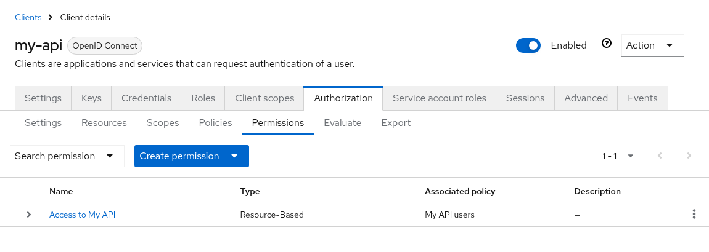
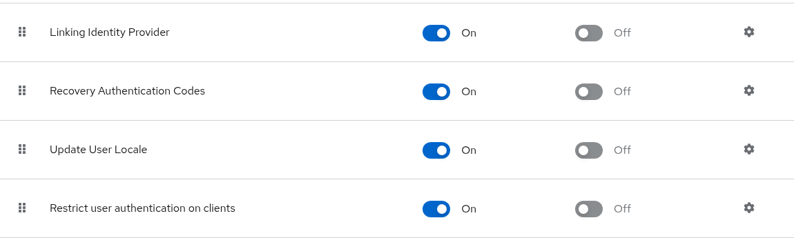
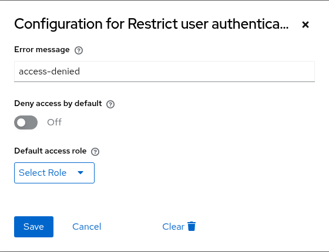
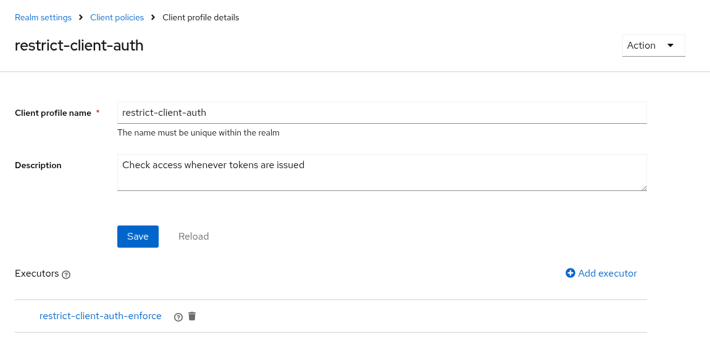
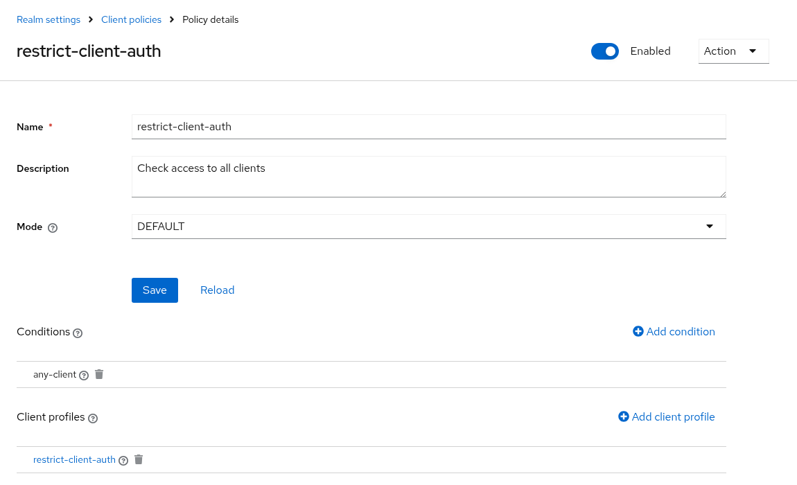
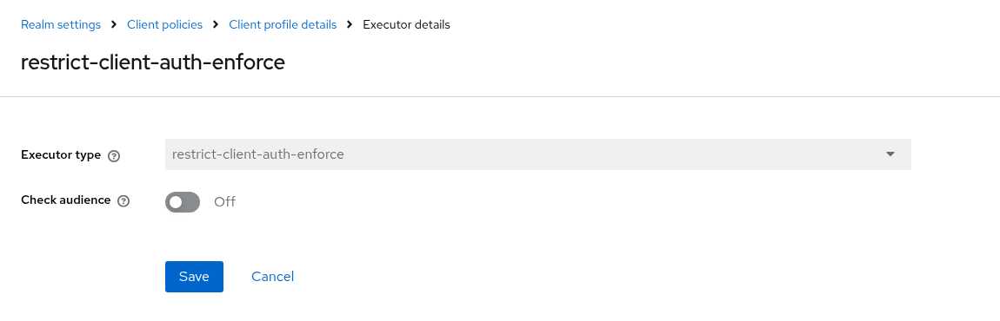

# Configuration
{: .no_toc }

## Table of contents
{: .no_toc .text-delta }

1. TOC
{:toc}

---

## Recommended setup

1. [Restrict clients](#restricting-clients) by adding the client role or the resource, manually or via the `restrict-client-auth-auto-config` [client policy executor](#automatically-restricting-new-clients).
2. Keep the [required action](#required-action) enabled. It is enabled by default and checks access at the end of every login.
3. Create a [client policy](#checking-access-whenever-tokens-are-issued) with the `any-client` condition and the `restrict-client-auth-enforce` client policy executor. It checks access whenever tokens are issued.
4. Optionally, [deny access by default](#denying-access-by-default).
5. Optionally, keep the [authenticator](authenticator.html) in your flows, e.g. to deny access before other required actions run, or to return a dedicated error for the resource owner password credentials grant.

## Upgrade notes

The required action is registered and enabled in all realms by default. This changes the behavior of realms with restricted clients:
* Users without access are now also denied if they log in via a path that bypassed the authenticator, e.g. single sign-on, identity provider redirects, password reset, registration, or links sent via email.
* The required action uses the [`auto` access provider](#using-client-roles-and-policies-in-the-same-realm), so it also enforces restrictions via policies. A leftover `Keycloak Client Resource` without a permission denies access to everyone. Remove restrictions you do not use.
* For the resource owner password credentials grant on restricted clients without the authenticator in the direct grant flow, Keycloak responds with `Account is not fully set up` for users without access.

To keep the previous behavior in a realm, [disable the required action](#disabling-the-required-action). If you are locked out, see [Locked out?](faq.html#locked-out).

For requests that do not accept HTML, e.g. the resource owner password credentials grant, the authenticator now responds with [errors according to RFC 6749](authenticator.html#error-responses-for-non-browser-requests): `invalid_grant` with status `400` from the token endpoint, and `access_denied` with status `403` otherwise. So far, it responded with `access-denied` and status `401`. Update clients that check for the previous error.

## Restricting clients

### Client role based

Add a client role named `restricted-access` to the client you want to restrict access to.



Afterwards, no user can access this client. To allow a user to access it, assign the role `restricted-access` of that client to the user. You may do so either by assigning the role to the user directly or via groups or composite roles.

Each client has its own `restricted-access` role, so you can grant access per client, e.g. assign the roles of several clients to a group. See [recipes](recipes.html#grant-access-to-several-clients-via-groups) for an example.

#### Changing the role name

You do not like the role name `restricted-access` or you do have some kind of naming conventions in place? You can change the role name globally by configuring the provider.

```properties
spi-restrict-client-auth-access-provider-client-role-enabled=true
spi-restrict-client-auth-access-provider-client-role-client-role-name=custom-role
```

For details on SPI and provider configuration, please refer to [Configuring providers](https://www.keycloak.org/server/configuration-provider) guide.

### Resource policy based

{: .note }
> Policy-based restrictions only work with confidential OpenID Connect clients, since Keycloak only supports authorization services for these clients. Use [client roles](#client-role-based) for public clients and SAML clients.

1. Open the client and switch on `Client authentication` and `Authorization` in the `Settings` tab.
2. Go to `Authorization` → `Resources` and click `Create resource`.
3. Set the `Name` and `Display name` to `Keycloak Client Resource` and keep the other fields blank.
4. Save the resource.
   
5. Click `Create permission` to add permissions and policies (see [Authorization Services Guide](https://www.keycloak.org/docs/latest/authorization_services/#_permission_overview) for details).
   
6. Afterwards, no user can access this client unless permissions have been granted by configured policies.

The [decision strategy](https://www.keycloak.org/docs/latest/authorization_services/#_permission_create) of the permission decides how multiple policies are combined, e.g. `Affirmative` grants access if any of the policies permits it.

### Using client roles and policies in the same realm

The `auto` access provider determines per client which restriction applies. For example, use client roles for public clients and policies for confidential clients.
* A client is restricted if any installed access provider restricts it, e.g. if it has the client role or the resource.
* Access is only permitted if all access providers that restrict the client permit it.

`auto` considers all installed access providers, including [custom ones](developer_info.html). The [required action](#required-action) and the `restrict-client-auth-enforce` [client policy executor](#checking-access-whenever-tokens-are-issued) always use `auto`. For the [authenticator](authenticator.html), select `auto` explicitly; its default access provider remains `client-role`.

### Automatically restricting new clients

The `restrict-client-auth-auto-config` [client policy executor](https://www.keycloak.org/docs/latest/server_admin/#executor) restricts clients when they are registered or updated, e.g. via the admin console or dynamic client registration. Configure the access provider in the executor: `client-role` adds the client role, `policy` adds the resource. It does not support `auto`, since it needs to know how to restrict access to a client.

Use the `restrict-client-auth-enabled` [client policy condition](https://www.keycloak.org/docs/latest/server_admin/#condition) to apply client policies only to restricted clients. It only applies when clients are registered or updated, so it cannot be used together with the `restrict-client-auth-enforce` executor.

## Required action

This extension provides a [required action](https://www.keycloak.org/docs/latest/server_admin/#con-required-actions_server_administration_guide) named `Restrict user authentication on clients` (`restrict-client-auth-enforce`).
Unlike the authenticator, the required action does not need to be added to any authentication flow.
Keycloak evaluates it whenever a user authenticates, no matter which authentication flow has been used, e.g. for login via username and password, single sign-on, identity providers, registration, credential reset, or links sent via email.

The required action always uses the [`auto` access provider](#using-client-roles-and-policies-in-the-same-realm), i.e. it checks all restrictions a client has.

Since Keycloak runs required actions after the authentication flow, access is checked after other required actions have been completed.
For example, users are able to reset their password before access to the client is denied.

The required action is registered and enabled in all realms by default: in existing realms on startup, and in new realms when they are created or imported. It is put at the bottom of the list of required actions, so that other required actions run first. If the required action is already registered in a realm, no matter whether enabled or disabled, it is left untouched.



Please note:
* Applications cannot initiate the required action via the `kc_action` parameter.
* For the resource owner password credentials grant (direct access grant), Keycloak denies access with an `Account is not fully set up` error instead. Add the authenticator to the direct grant flow or use the `restrict-client-auth-enforce` [client policy executor](#checking-access-whenever-tokens-are-issued) for a dedicated error.

### Disabling the required action

1. Go to `Authentication` and choose the `Required actions` tab.
2. Switch off `Restrict user authentication on clients`.

Do not remove the required action, e.g. via the admin REST API. A removed required action is registered and enabled again on the next start.

### Configuring the required action

Choose the gear icon of `Restrict user authentication on clients` to configure the [error message](error-messages.html) and the [realm settings](#realm-settings).



## Checking access whenever tokens are issued

The `restrict-client-auth-enforce` [client policy executor](https://www.keycloak.org/docs/latest/server_admin/#executor) denies issuing tokens for users who do not have access to a restricted client (anymore).
Unlike the authenticator, the executor does not depend on authentication flows. Keycloak does not run any authentication flow when a client refreshes or exchanges a token, and the authenticator may be skipped during login, e.g. if users log in via single sign-on or an identity provider.

The executor checks access
* whenever an authorization code is exchanged for tokens, and when tokens are issued via the resource owner password credentials grant or the JWT authorization grant (Keycloak 26.8 or later). It responds with an `invalid_grant` error if access is denied.
* whenever tokens are issued via the device authorization grant, client initiated backchannel authentication (CIBA), or the implicit or hybrid flow. It responds with an `access_denied` error if access is denied.
* whenever a token, including an offline token, is refreshed. It responds with an `invalid_grant` error if access is denied.
* whenever a token is exchanged using [standard token exchange](https://www.keycloak.org/securing-apps/token-exchange). It checks access to the requesting client and to all clients requested via the `audience` parameter and responds with an `access_denied` error if access is denied to any of them. This requires Keycloak 26.8 or later. Legacy token exchange (V1), e.g. impersonation or external to internal token exchange, is not covered.

Tokens for service accounts (client credentials grant) are not checked. SAML clients are not covered either, since SAML does not use the token endpoint.

The executor always uses the [`auto` access provider](#using-client-roles-and-policies-in-the-same-realm), i.e. it checks all restrictions a client has.

To enable the executor:

1. Go to `Realm settings` → `Client policies` → `Profiles`, create a client profile and add the `restrict-client-auth-enforce` executor to it.
   
2. Go to `Policies`, create a client policy, and add the `any-client` condition and the client profile to it.
   

### Checking the audience

By default, the executor checks access to the client the tokens are issued for, i.e. the authorized party (`azp`), and, for token exchange, to the requested audience.
Access tokens may contain further clients in their audience (`aud`), e.g. added by audience mappers or because the user has roles of these clients.
Enable the `Check audience` option (`checkAudience`) to also check access to all clients in the audience of the access token. Tokens are denied if the user does not have access to any of them. Audience values that are no client IDs of the realm are ignored.



## Realm settings

The configuration of the required action also holds settings for the whole realm.
`Deny access by default` and `Default access role` apply to all enforcement points of the realm: the authenticator, the required action, and the `restrict-client-auth-enforce` and `restrict-client-auth-auto-config` client policy executors.
They apply even if the required action is disabled. It only has to be registered.

| Setting | Key | Applies to | Description |
|---|---|---|---|
| Error message | `restrictClientAuthErrorMessage` | Required action | The error message shown by the required action, see [error messages](error-messages.html). |
| Error message after password update | `passwordUpdatedErrorMessage` | Required action | The error message shown by the required action if users updated their password during the same login, e.g. after resetting it. If blank, the error message is used. See [error messages](error-messages.html#message-after-a-password-update). |
| Deny access by default | `defaultDeny` | Whole realm | If enabled, all clients of the realm are restricted. See [Denying access by default](#denying-access-by-default). |
| Default access role | `defaultAccessRole` | Whole realm | If access is denied by default, users with this role may access all clients that are not restricted by the access provider. Use the role name for realm roles and `client-id.role-name` for client roles. |

Without these settings, the extension behaves exactly as before.

If the default access role does not exist, access to clients that are not restricted by the access provider is denied and a warning is logged.

### Configuring realm settings in the admin console

1. Go to `Authentication` and choose the `Required actions` tab.
2. Choose the gear icon of `Restrict user authentication on clients` and configure the settings.

The admin console validates the settings when saving. Default access roles that do not exist are rejected.

### Configuring realm settings via the admin REST API

```shell
curl -X PUT "$KEYCLOAK_URL/admin/realms/$REALM/authentication/required-actions/restrict-client-auth-enforce/config" \
  -H "Authorization: Bearer $ACCESS_TOKEN" -H "Content-Type: application/json" \
  -d '{"config": {"defaultDeny": "true", "defaultAccessRole": "default-access"}}'
```

The `config` endpoint validates the settings and responds with `400 Bad Request` if the default access role does not exist.

If the required action has been removed from the realm, register it first:

```shell
curl -X POST "$KEYCLOAK_URL/admin/realms/$REALM/authentication/register-required-action" \
  -H "Authorization: Bearer $ACCESS_TOKEN" -H "Content-Type: application/json" \
  -d '{"providerId": "restrict-client-auth-enforce", "name": "Restrict user authentication on clients"}'
```

### Configuring realm settings via Terraform

Use the `keycloak_required_action` resource of the [Keycloak Terraform provider](https://registry.terraform.io/providers/keycloak/keycloak/latest/docs/resources/required_action):

```hcl
resource "keycloak_required_action" "restrict_client_auth" {
  realm_id = keycloak_realm.realm.realm
  alias    = "restrict-client-auth-enforce"
  name     = "Restrict user authentication on clients"
  enabled  = true
  config = {
    defaultDeny       = "true"
    defaultAccessRole = "default-access"
  }
}
```

### Realm export and import

The realm settings are part of the required action in the realm representation and hence part of realm exports and imports, e.g. with [keycloak-config-cli](https://github.com/adorsys/keycloak-config-cli):

```json
"requiredActions": [
  {
    "alias": "restrict-client-auth-enforce",
    "name": "Restrict user authentication on clients",
    "providerId": "restrict-client-auth-enforce",
    "enabled": true,
    "config": {
      "defaultDeny": "true",
      "defaultAccessRole": "default-access"
    }
  }
]
```

{: .warning }
> Keycloak only validates the realm settings when they are saved via the admin console or the `config` endpoint. Settings applied via Terraform, which uses the required action endpoint, or via realm import are not validated. Invalid settings deny access at runtime and are logged as warnings, so check the logs after applying them.

## Denying access by default

By default, only restricted clients restrict access, i.e. clients that have the client role or the resource. All other clients are accessible to all users. If you forget to restrict a client, e.g. when introducing a new user pool, all users can access it.

If you enable `Deny access by default` in the realm settings, all clients of the realm are restricted:
* Access to clients that are restricted by the access provider is decided as usual.
* Access to all other clients is only permitted for users with the default access role. If no default access role is set, access to these clients is denied.
* If the access provider of an authenticator or a client policy executor does not exist, it denies access to all clients.

The required action and the `restrict-client-auth-enforce` client policy executor apply this to all restrictions a client has, since they always use the [`auto` access provider](#using-client-roles-and-policies-in-the-same-realm). Each authenticator applies it to its own access provider. If you use different access providers in the same realm, select `auto` for your authenticators as well.

For example, assign the default access role to your existing users via a group. They keep access to all existing clients. Users without the role, e.g. users of a new user pool, may only access clients that are restricted and that they have been granted access to. If you forget to restrict a client, users without the default access role cannot access it.

Do not add the default access role to the realm's default roles, since all new users get these roles.

{: .warning }
> Denying access by default also applies to Keycloak's built-in clients, e.g. `account-console`. In the admin realm (`master` by default), it also applies to `security-admin-console` and `admin-cli`. Make sure that administrators can still access the admin console and admin REST API before denying access by default in the admin realm. Keycloak logs a warning if access is denied by default in the admin realm. If you are locked out, see [Locked out?](faq.html#locked-out).
