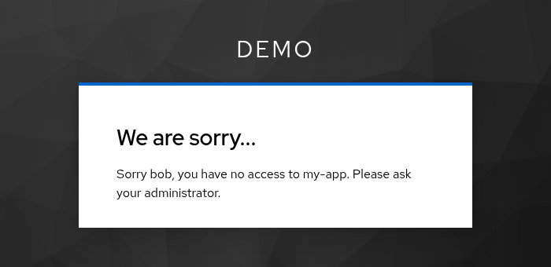

# Error messages
{: .no_toc }

## Table of contents
{: .no_toc .text-delta }

1. TOC
{:toc}

---

If access is denied during a browser-based login, Keycloak shows an error page.



## Configuring the error message

Configure the error message in the [required action](configuration.html#configuring-the-required-action) and in each [authenticator](authenticator.html#configuring-the-authenticator) (`restrictClientAuthErrorMessage`).

You can directly define a particular message or use a message key. Keycloak looks up message keys in the messages of the login theme, so they support internationalization.

If the field is left blank, the message key `access-denied` is used. It comes with Keycloak out of the box.

Messages defined via message keys can contain two parameters:

| Parameter | Value |
|---|---|
| `{0}` | The username |
| `{1}` | The client ID of the client the user tried to access |

Parameters are only replaced in messages defined via message keys, not in messages entered directly as the error message.

## Defining messages without a custom theme

Define the message via realm overrides:

1. Go to `Realm settings` → `Localization` → `Realm overrides`.
2. Add a translation for your message key, e.g. `restricted-access.denied`, per language.
3. Use the message key as the error message.

```properties
restricted-access.denied=Sorry {0}, you have no access to {1}. Please ask your administrator.
```

## Defining messages in a custom theme

Add your message key to the `messages*.properties` files of your login theme.

```properties
# messages.properties
restricted-access.denied=Access denied. User is missing required role 'restricted-access'
# messages_de.properties
restricted-access.denied=Zugriff verweigert. Dem Benutzer fehlt die notwendige Rolle 'restricted-access'.
```

For details on how to add custom messages to Keycloak, please refer to section [Messages and Internationalization](https://www.keycloak.org/docs/latest/server_development/#messages) in the server developer guide.

## Different messages per client

Clients may be restricted for different reasons, e.g. users need to have paid a fee for one client and to live in a certain area for another. There are several ways to show different messages:

* **One message for all clients, naming the client:** use the `{1}` parameter in a message key, e.g. `You cannot access {1}. Please contact the service desk.`
* **A login theme per client:** Keycloak lets you select the `Login theme` per client in the client settings. Override your message key in the theme of each client.
* **An authenticator per client:** add the [authenticator](authenticator.html) with its own error message to a flow and bind the flow to the client via `Authentication flow overrides` in the advanced client settings. The authenticator denies access during the flow, before the required action runs, so users see the message of the authenticator.
