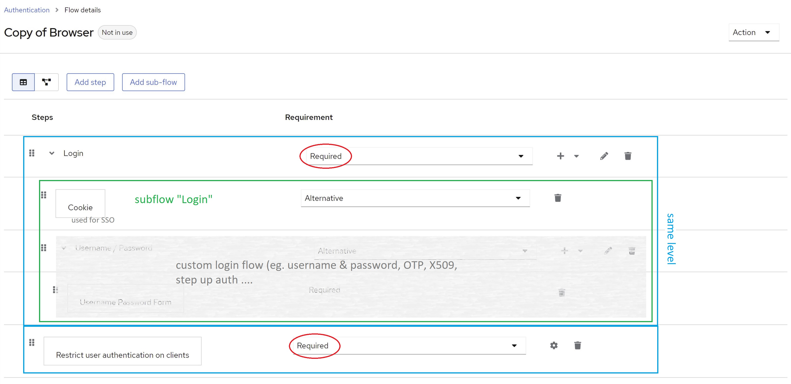

# Frequently asked questions
{: .no_toc }

## Table of contents
{: .no_toc .text-delta }

1. TOC
{:toc}

---

## Locked out?

If users cannot log in to a realm because of the extension, log in to the admin console of the admin realm and [disable the required action](configuration.html#disabling-the-required-action) in that realm, or fix the restriction.

If you are locked out of the admin realm itself, e.g. after denying access by default there, you have two options.

### Use a temporary admin service account

Stop Keycloak and create a temporary admin service account. It logs in via the client credentials grant, which the extension does not check, unless [`Check service accounts`](configuration.html#checking-service-accounts) is enabled in the admin realm. The command prompts for a client secret.

```shell
bin/kc.sh bootstrap-admin service --client-id=temp-admin
```

Start Keycloak again and use the service account with the [Admin CLI](https://www.keycloak.org/docs/latest/server_admin/#admin-cli) to fix the configuration, e.g. to disable denying access by default, to remove a restriction, or to bind the default browser flow if the authenticator causes the lockout:

```shell
kcadm.sh config credentials --server http://localhost:8080 --realm master --client temp-admin --secret <secret>
kcadm.sh update realms/master -s browserFlow=browser
```

Delete the service account afterwards.

### Disable the required action provider

If the required action causes the lockout, disable the required action provider via the server configuration, e.g. in `conf/keycloak.conf`:

```properties
spi-required-action--restrict-client-auth-enforce--enabled=false
```

or as a command line option:

```shell
bin/kc.sh start --spi-required-action--restrict-client-auth-enforce--enabled=false
```

Keycloak 26.2 does not support this format with `--` separators and ignores it. Use `spi-required-action-restrict-client-auth-enforce-enabled=false` there.

Keycloak then skips the required action in all realms, even though it is still registered and enabled. Since this is a build time option, run `bin/kc.sh build` again if you use an optimized server image. Log in, fix the configuration, remove the option, and restart Keycloak.

## Why are users denied access after upgrading?

The [required action](configuration.html#required-action) is enabled by default. It checks access at the end of every login, also for paths that did not run through the authenticator before, e.g. single sign-on or identity provider redirects. It checks all restrictions a client has, including leftover `Keycloak Client Resource`s without a permission. See the [upgrade notes](configuration.html#upgrade-notes).

## Why do I get `Account is not fully set up` for the direct grant?

Keycloak evaluates required actions for the resource owner password credentials grant, but cannot show them to the user. If the required action denies access, Keycloak rejects the grant with this error. Add the authenticator to the direct grant flow or use the `restrict-client-auth-enforce` [client policy executor](configuration.html#checking-access-whenever-tokens-are-issued) for a dedicated error.

## Why is the required action enabled again after I removed it?

The required action is registered and enabled on every start in all realms in which it is not registered. [Disable it](configuration.html#disabling-the-required-action) instead of removing it. A disabled required action stays disabled.

## Do I still need the authenticator?

No. The [required action](configuration.html#required-action) and the `restrict-client-auth-enforce` [client policy executor](configuration.html#checking-access-whenever-tokens-are-issued) check access on all paths. See [Authenticator and flows](authenticator.html) for cases in which the authenticator is still useful.

## Does it work with Keycloak version X.Y.Z?

If you are using Keycloak version `X` (e.g. `X.y.z`), version `X.b.c` should be compatible.
Keycloak SPIs are quite stable. So, there is a high chance this extension will work with other versions, too. Check the details of latest [compatibility test run](https://github.com/sventorben/keycloak-restrict-client-auth/actions/workflows/matrix.yml) for an overview or simply give it a try.

Extension version `X.b.c` is compiled against Keycloak version `X.y.z`. For example, version `16.3.1` will be compiled against Keycloak version `16.y.z`.

I do not guarantee what version `a.b` or `y.z` will be. Neither do I backport features to older version, nor maintain any older versions of this extension. If you need the latest features or bugfixes for an older version, please fork this project or update your Keycloak instance. I recommend doing the latter on regular basis anyways.

## Why not use "Allow/Deny Access" authenticators with conditions?

With Keycloak 13 two new authenticators have been added, namely `Allow Access` and `Deny Access`. Together with `Condition - User Role` authenticator authentication may be restricted in a similar way with out-of-the-box features. So, the question is why not use that and override authentication flows on a per client basis?

Here are some reasons/thoughts
* It is not really flexible. Since `Condition - User Role` only allows for checking one concrete (realm or client-specific) role, a very complex flow handling all clients, or a totally separate flow for each individual client would be needed.
* It simply does not work well with federated authentication (ie. identity provider redirects), since there is no way to configure client specific behaviour for `First login flow` or `Post login flows`. In other words, there is no feature like `Authentication flow overrides` at an IdP level. Hence, the same flow will be used for all clients. As said before, this becomes very complicated.
* No authentication flow runs when tokens are refreshed or exchanged. The client policy executor of this extension checks access in these cases, too.

## Getting error KC-SERVICES0013: Failed authentication

When getting an error or warning like this,
```
WARN  [org.keycloak.authentication.DefaultAuthenticationFlow] (default task-26) REQUIRED and ALTERNATIVE elements at same level! Those alternative executions will be ignored: [auth-cookie, identity-
provider-redirector, null]
WARN  [org.keycloak.services] (default task-26) KC-SERVICES0013: Failed authentication: org.keycloak.authentication.AuthenticationFlowException: authenticator: restrict-client-auth-authenticator
```

you have most likely mixed required and alternative subflows/steps/authenticators at the same level in your custom flow.
Keycloak does not support this.

Make sure you do not combine required and alternative authenticators at the same level.
See the following image for details:


